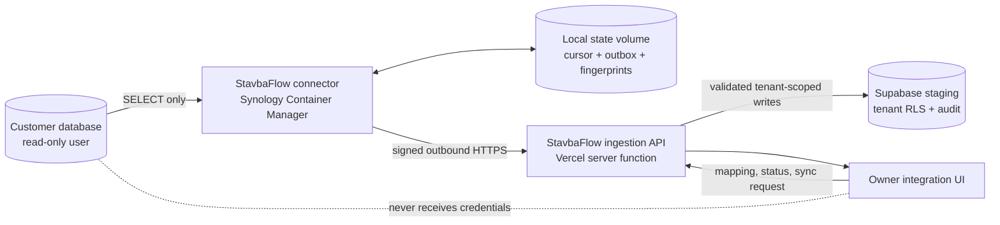

# StavbaFlow Synology database connector — design

Date: 2026-10-04

Status: approved for implementation planning

Target: first sellable pilot for a small construction company (1–10 people)

## 1. Goal

Build a production-quality, read-only connector that a customer can run on a Synology NAS. It imports selected business data from PostgreSQL, MySQL/MariaDB, or Microsoft SQL Server into the customer's isolated StavbaFlow workspace. The connector must continue syncing after installation without exposing database credentials to the browser or writing back to the customer's database.

The first pilot must support:

- customers and contacts;
- inquiries and leads;
- projects, jobs, and external project statuses;
- employee directory records and project assignments;
- invoices and payments as read-only financial context;
- explicitly mapped additional tables;
- a dry-run preview before the first import;
- incremental synchronization every minute and a manual **Sync now** action;
- clear operational status and recoverable per-record failures.

This subsystem closes the database-integration part of the sales-readiness audit. It does not by itself make the whole product ready to sell. Login, invitations, the public intake form, tenant isolation, legal review, and the pilot acceptance flow retain their existing release criteria.

## 2. Agreed product rules

1. The customer's database remains the source of truth for imported customer, contact, invoice, payment, and project fields.
2. StavbaFlow owns workflow state, internal notes, employee login accounts, assignments created in StavbaFlow, and audit history.
3. The connector never writes to the customer's source database.
4. A deleted source record is archived in StavbaFlow. It is never hard-deleted automatically.
5. Imported employee directory records do not become login users. An owner must send a separate invitation before a person receives access.
6. Invoices and payments are view-only in the first version.
7. The first synchronization is always a dry run. The owner reviews mapping, validation errors, and estimated changes before enabling import.
8. One invalid record does not stop a batch. Failed records enter a retry queue and appear in the integration status.
9. Production Supabase, production migrations, and real customer databases remain untouched during development and automated testing.

## 3. Non-goals for the first pilot

- bidirectional synchronization or any write-back to a customer database;
- change-data-capture based on WAL, binlog, or SQL Server replication;
- automatic creation of employee login accounts from imported rows;
- automatic deletion of StavbaFlow records;
- automatic mapping that silently accepts unknown fields;
- database credentials stored in Vercel, Supabase, StavbaFlow, or the browser;
- schema migrations applied automatically to staging or production;
- live SQL browsing from the web application;
- a promise to support arbitrary database schemas without customer-specific mapping.

These exclusions keep the pilot supportable and prevent the connector from becoming a remote database administration tool.

## 4. System architecture



The connector is an independent TypeScript service shipped as a multi-architecture Docker image for `linux/amd64` and `linux/arm64`. It is installed as a Synology Container Manager project from a Compose file. It initiates all network traffic. No inbound port, VPN, public NAS endpoint, Docker socket mount, or port forwarding is required.

The StavbaFlow application provides tenant-bound enrollment, mapping, ingestion, and status APIs. Imported records pass through a canonical contract instead of writing directly to application tables. This preserves a stable boundary when either a customer's source schema or the internal StavbaFlow schema changes.

## 5. Connector components

The connector will live in a focused workspace under `connector/` and contain these units:

### 5.1 Configuration loader

Reads configuration from a mounted file or Docker secrets. Required values are the source database type and connection parameters, the StavbaFlow API URL, the connector identity, and the locally generated private signing key. Environment variables may point to secret files, but secret values must not be printed or returned by health endpoints.

The startup check rejects:

- missing TLS requirements for a remote database unless the owner explicitly configures a local trusted network exception;
- database accounts with more permissions than required when the engine exposes enough metadata to detect them;
- unknown database drivers;
- a writable source session when a safe write-denial probe can be performed inside a rolled-back transaction;
- mapping files with unknown destination entities or fields.

### 5.2 Source adapters

All database engines implement one interface:

```ts
interface SourceAdapter {
  testConnection(): Promise<ConnectionReport>;
  inspectSchema(selection?: SourceSelection): Promise<SourceSchema>;
  readPage(query: IncrementalQuery): Promise<SourcePage>;
  verifyReadOnly(): Promise<ReadOnlyReport>;
  close(): Promise<void>;
}
```

Adapters are provided for PostgreSQL, MySQL/MariaDB, and Microsoft SQL Server. Queries use bound parameters and quoted identifiers from inspected metadata. User-provided values are never concatenated into SQL. The connector exposes only allowlisted tables and columns from its local mapping.

### 5.3 Mapping engine

The mapping engine converts source rows to versioned canonical entities:

- `customer.v1`
- `contact.v1`
- `lead.v1`
- `project.v1`
- `employee_directory.v1`
- `invoice.v1`
- `payment.v1`
- `custom_record.v1`

Each record includes `source_system`, `source_table`, `external_id`, `source_updated_at` when available, a canonical payload, and a deterministic fingerprint. Mapping is explicit per company. Unknown source fields are ignored until mapped; unknown destination fields fail validation.

The owner can map, rename, combine, and apply simple typed conversions to source fields. The first version supports text, number, boolean, date/time, email, phone, currency, and enum lookup conversions. Arbitrary customer JavaScript or SQL expressions are not allowed.

### 5.4 Incremental reader

Preferred synchronization uses a compound watermark `(updated_at, primary_key)` so equal timestamps do not skip rows. If no reliable update timestamp exists, the connector performs ordered primary-key scans and compares fingerprints. A scheduled full reconciliation detects changes and deletions that an incremental cursor cannot observe.

The cursor advances only after the ingestion API acknowledges the corresponding outbox entries. Replaying the same page is safe because the server enforces idempotency using connector, entity type, external ID, and fingerprint.

### 5.5 Durable local state

The connector uses a mounted directory at `/var/lib/stavbaflow`. State is stored as small versioned JSON documents and an append-only filesystem outbox. Every write uses a temporary file, flush, and atomic rename. This avoids a native embedded-database dependency across Synology CPU architectures.

The state contains no source passwords. It contains connector identity, public metadata, cursors, fingerprints, pending event payloads, retry counters, and the last known stable software digest. File permissions restrict access to the container user and the Synology administrator.

### 5.6 Scheduler and command channel

Automatic synchronization runs every minute. The connector also polls for a signed, tenant-bound command that can request **Sync now**, pause, resume, refresh mapping, or rotate identity. Commands carry a unique ID and expiry and are acknowledged once, preventing replay.

Five consecutive run-level failures pause automatic synchronization. Record-level validation failures produce `partial_failure` without pausing successful records. The owner can retry failed records after correcting the mapping.

## 6. Enrollment and request security

An owner or platform administrator creates a one-time enrollment code for exactly one company. It expires after 15 minutes and can be consumed once.

On first start, the connector generates an Ed25519 key pair locally. It exchanges the enrollment code and public key for a connector ID. The private key never leaves the NAS. StavbaFlow stores the public key, company ID, status, scopes, creation time, and revocation state. This avoids storing a reusable customer connector secret in the application database.

Every connector request includes:

- connector ID;
- request ID;
- timestamp;
- canonical body hash;
- Ed25519 signature.

The API rejects expired timestamps, reused request IDs, revoked connectors, invalid signatures, company mismatches, unknown entity versions, oversized batches, and unknown fields. Enrollment and ingest endpoints are rate-limited separately. Server logs redact connection strings, credentials, tokens, signatures, customer field values, and raw rows.

The connector has only `ingest`, `heartbeat`, and `commands:read` scopes. It cannot query general company data or invoke owner/admin functions.

## 7. Server ingestion and staging data model

The implementation will propose reviewed migrations for the isolated staging Supabase project only. No migration is applied automatically. The minimum model is:

- `app_connectors`: tenant-bound connector identity, public key, status, version, last heartbeat, and revocation;
- `app_connector_enrollments`: hashed one-time enrollment codes, company, creator, expiry, and consumed time;
- `app_connector_mappings`: versioned validated mapping owned by a company;
- `app_sync_runs`: start/end time, status, counts, error summary, connector version, and mapping version;
- `app_external_records`: tenant, connector, canonical entity type, external ID, fingerprint, source timestamps, archive state, and internal destination reference;
- `app_connector_commands`: short-lived commands with acknowledgement;
- existing audit storage extended with enrollment, mapping, sync, archive, retry, pause, resume, and revoke events.

Only server-side service code can write connector protocol tables. Browser clients can read tenant-scoped status and manage mappings through narrow owner-only RPC/API operations. Employee sessions cannot enroll, reconfigure, pause, revoke, or inspect integration error details.

Ingestion validates the entire envelope, then processes records independently in a transaction boundary appropriate to the batch size. Ownership rules prevent source data from overwriting StavbaFlow-owned fields. A source deletion sets the external record and linked business record to archived where the business rule permits it; it never deletes audit history, assignments, or notes.

## 8. Ownership and conflict rules

| Entity/field | Source database | StavbaFlow | Conflict behavior |
| --- | --- | --- | --- |
| Customer identity and contact data | Owner | Read-only mirror | Source update wins |
| Contact identity and details | Owner | Read-only mirror | Source update wins |
| Lead source fields | Owner when imported | Workflow fields | Each side owns its fields |
| Project identity and external status | Owner | Internal workflow, notes, assignments | Each side owns its fields |
| Employee directory details | Owner | Login membership and permissions | Never auto-create login |
| Invoice/payment facts | Owner | View only | Source update wins |
| Internal notes and audit | None | Owner | Never overwritten |

If a mapping change would reinterpret existing data, StavbaFlow creates a new mapping version and requires a dry run. It never silently rewrites previous records.

## 9. Owner experience

The existing Integrations area will gain a truthful **Synology / company database** setup flow:

1. Choose database type.
2. Download the Compose bundle and installation instructions.
3. Generate a short-lived enrollment code.
4. See the connector heartbeat and read-only verification result.
5. Inspect available tables and columns without displaying sample customer rows by default.
6. Map source fields to canonical entities.
7. Run a synthetic/metadata-first dry run showing counts, field validity, and a small masked preview only when explicitly enabled.
8. Approve the first import.
9. Monitor last sync, next sync, processed/changed/failed counts, connector version, and mapping version.
10. Pause, resume, sync now, retry failures, rotate enrollment, or revoke the connector.

The UI must distinguish `not_configured`, `awaiting_enrollment`, `mapping_required`, `dry_run_required`, `ready`, `running`, `success`, `partial_failure`, `paused`, `outdated`, and `revoked`. It must never show sample records as a successful live connection.

## 10. Error handling and recovery

- Network failures retain events in the local outbox with exponential backoff and jitter.
- HTTP `429` and transient `5xx` responses are retried; validation and authorization failures require operator action.
- Failed rows record a safe error code and mapped field name, never the full source row.
- A connector restart resumes from the acknowledged cursor and pending outbox.
- Duplicate delivery returns a successful idempotent acknowledgement.
- Mapping changes suspend ingestion until their required dry run succeeds.
- Revocation is effective at the API immediately; a revoked connector cannot re-enroll with its old code or identity.
- Clock skew produces a clear health error and installation guidance because signed requests require bounded timestamps.

## 11. Packaging and updates

GitHub Actions builds and tests the connector image for `linux/amd64` and `linux/arm64` on each connector PR. Merges to `main` publish a versioned image and a `stable` channel to GitHub Container Registry only after the full connector integration suite passes. The deployed Compose configuration pins the selected image digest.

The image contains no customer credentials or StavbaFlow secrets, so the initial distribution is a public GHCR package. This avoids requiring every small customer to maintain a GitHub package token. A private-registry mode can be added later if commercial distribution requires it.

Automatic updates are performed by a separate host-side script scheduled through Synology Task Scheduler. The connector never receives the Docker socket. The updater:

1. fetches the stable release manifest over HTTPS;
2. resolves and records the immutable image digest;
3. pulls the candidate image;
4. starts it with the unchanged mounted configuration and state;
5. waits for connector health, configuration validation, and a successful signed heartbeat;
6. keeps the candidate on success or restores the previous digest on failure.

An update never changes mapping or credentials. The owner can disable automatic updates or pin a version. A server-side rollout switch can pause distribution of a bad release. GitHub artifact attestations are optional because private-repository attestation availability depends on the GitHub plan; digest pinning and tested release provenance are the required baseline.

## 12. Verification strategy

### 12.1 Unit and contract tests

- canonical mapping and type conversion;
- field allowlists and ownership enforcement;
- fingerprint stability;
- compound cursor behavior at equal timestamps;
- idempotency and replay rejection;
- request signature, expiry, connector revocation, and company binding;
- redaction of credentials and customer values;
- archive semantics;
- retry classification and five-failure pause behavior.

### 12.2 Container integration tests

CI starts synthetic PostgreSQL, MariaDB, and SQL Server containers. Each adapter is tested with a restricted read-only account. Tests prove that SELECT succeeds and INSERT/UPDATE/DELETE fail. Fixtures contain only synthetic data.

For every engine the suite verifies:

1. initial dry run does not write business records;
2. approved initial import creates expected canonical records;
3. a source update is synchronized;
4. replay does not create duplicates;
5. a network outage queues data and recovery drains it;
6. one malformed row causes partial failure while valid rows continue;
7. a source deletion archives the mirror;
8. a mapping version change requires a new dry run.

### 12.3 Tenant-isolation staging tests

The staging acceptance test uses two synthetic companies, two owners, and at least one employee. It proves through the real API and database policies that:

- connector A can ingest only for company A;
- connector B can ingest only for company B;
- forged company IDs and cross-tenant external IDs are rejected;
- owner A cannot read connector B status or records;
- employees cannot manage connectors;
- imported employees receive no login access until invited;
- a revoked connector cannot send another event.

### 12.4 Browser verification

The complete owner flow is verified in a deployed preview: login, enrollment creation, simulated connector heartbeat, mapping, dry run, import approval, sync status, a visible imported lead/project, manual sync, a partial failure, retry, pause, and revoke. Mobile and desktop layouts are checked. The browser test must confirm UI claims against API responses; a green build alone is insufficient.

### 12.5 Required checks

Repository checks remain:

- `npm ci`
- `npm test`
- `npm run lint`
- `npm run build`
- connector unit tests
- three-engine container integration suite
- image vulnerability scan with no unresolved critical finding
- secret scan of staged changes and built image metadata
- staging tenant-isolation E2E
- deployed-preview browser verification

## 13. Delivery sequence

Work is divided into reviewable branches and PRs, with no direct changes to `main` and no auto-merge:

1. **Protocol and connector core** — canonical contracts, signing, state/outbox, scheduler, dry-run behavior, and synthetic API.
2. **Database adapters** — PostgreSQL, MySQL/MariaDB, SQL Server, read-only verification, mapping inspection, and container tests.
3. **Staging ingestion** — reviewed staging migration proposal, server APIs, RLS/RPC policy tests, idempotency, archive behavior, and audit events.
4. **Dashboard integration** — enrollment, mapping, dry run, status, manual sync, retry, pause, revoke, and browser tests.
5. **Packaging and release** — multi-architecture build, GHCR publishing, Synology Compose bundle, updater, health check, rollback, vulnerability scan, and installation runbook.
6. **Pilot acceptance** — two-company staging test, real Synology installation rehearsal, full browser flow, support/rollback rehearsal, and updated sales-readiness audit.

Later PRs may depend on earlier ones, so they should be prepared in sequence rather than merged simultaneously. Each PR must be independently reviewable and preserve fail-closed behavior when the next layer is absent.

## 14. Audit closure and release boundary

This design directly addresses the audit findings about simulated SQL connectivity, fake Google Sheets success, partial preview imports, hidden delivery failures, missing provenance, missing idempotency, and lack of tenant-isolated integration proof.

The product may claim **Synology database integration available for pilot** only after all of these are demonstrated:

- a customer-like Synology installation completes from the documented bundle;
- all three advertised database engines pass automated adapter tests;
- at least the pilot customer's actual engine passes a supervised read-only connection test;
- first import, incremental sync, archive, retry, restart recovery, and upgrade rollback pass;
- two-company isolation passes against staging RLS and the real API;
- the UI never substitutes demo data for an unavailable integration;
- operating and support runbooks identify backup, revoke, rotate, pause, rollback, and incident steps.

It may not be marketed as bidirectional synchronization. Supported source systems and mapped entities must be stated per customer. Production enablement still requires a separate reviewed release decision; this design does not authorize production writes or deployment.

## 15. Business and legal presentation

The application and sales surface may identify the provider as **Hynek Svoboda**, address **Vincence Makovského 4428/11**, and contact **svobonek@gmail.com**. No IČO will be invented or displayed. Terms, privacy text, data-processing terms, and invoice requirements remain marked for professional legal/accounting review before paid operation.

## 16. Operational assumptions

- The NAS can run Synology Container Manager projects from Compose YAML.
- Outbound HTTPS from the NAS to the StavbaFlow API and GHCR is allowed.
- The customer or installer can create a database user limited to required schemas/tables and SELECT metadata/data permissions.
- The source tables have stable primary keys. Efficient minute-level sync additionally requires reliable update timestamps; without them, the UI will disclose that reconciliation is slower.
- The first public connector image contains no proprietary customer logic or embedded secrets. If this assumption changes, distribution moves to an authenticated registry before release.
- Staging uses only synthetic data. Production metadata may be inspected only through the already approved read-only mechanism.

## 17. Reference documentation

- Synology Container Manager projects: <https://kb.synology.com/en-uk/DSM/help/ContainerManager/docker_project?version=7>
- GitHub Actions Docker image publishing: <https://docs.github.com/en/actions/tutorials/publish-packages/publish-docker-images?learn=continuous_deployment>
- GitHub Container Registry authentication: <https://docs.github.com/en/packages/working-with-a-github-packages-registry>
- GitHub artifact attestations and plan limits: <https://docs.github.com/en/actions/concepts/security/artifact-attestations>
